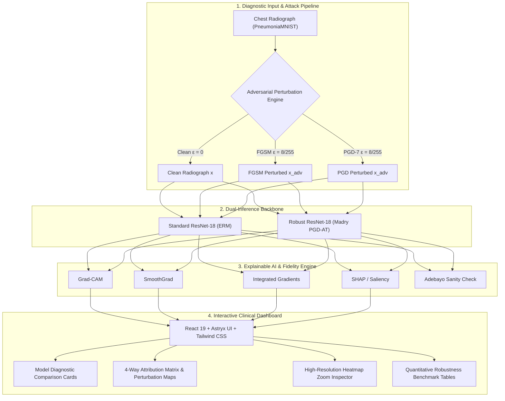

<div align="center">

# 🩺 Trustworthy Medical AI: Robustness & Explainability in Radiographic Diagnostics

**A Full-Stack Framework and Interactive Dashboard for Investigating Adversarial Vulnerabilities, Min-Max Adversarial Defense, and Saliency Fidelity in Chest X-Ray Models**

[](https://www.python.org/)
[](https://pytorch.org/)
[](https://medmnist.com/)
[](https://react.dev/)
[](https://github.com/astryxdesign)
[](https://tailwindcss.com/)

---

### *Atal Bihari Vajpayee Indian Institute of Information Technology and Management (ABV-IIITM), Gwalior*
**Course:** Trustworthy Artificial Intelligence (TAI) &bull; **Capstone Research Project**

</div>

---

## 📑 Table of Contents

- [Executive Summary](#-executive-summary)
- [Key Research Highlights & Empirical Findings](#-key-research-highlights--empirical-findings)
- [System Architecture](#-system-architecture)
- [Methodology & Formulations](#-methodology--formulations)
  - [1. Adversarial Attack Formulations (FGSM, PGD)](#1-adversarial-attack-formulations)
  - [2. Madry's Min-Max Adversarial Training](#2-madrys-min-max-adversarial-training)
  - [3. Explainable AI (XAI) Suite](#3-explainable-ai-xai-suite)
  - [4. Adebayo Model Randomization Sanity Checks](#4-adebayo-model-randomization-sanity-checks)
- [Interactive Clinical Dashboard](#-interactive-clinical-dashboard)
- [Repository Structure](#-repository-structure)
- [Getting Started](#-getting-started)
  - [Prerequisites](#prerequisites)
  - [Mode A: Local Deployment (Zero GPU Required)](#mode-a-local-deployment-zero-gpu-required)
  - [Mode B: GPU-Accelerated Live Inference (Colab / Kaggle)](#mode-b-gpu-accelerated-live-inference-colab--kaggle)
- [REST API Specification](#-rest-api-specification)
- [Research Notebook Guide](#-research-notebook-guide)
- [Key References](#-key-references)

---

## 🔬 Executive Summary

Deep learning models deployed in clinical imaging achieve high nominal diagnostic accuracy. However, in safety-critical clinical environments, standard Empirical Risk Minimization (ERM) models display severe vulnerabilities:

1. **Adversarial Fragility**: Quasi-imperceptible perturbations ($\epsilon \le 8/255$) mathematically crafted along loss gradients cause catastrophic diagnostic misclassifications (e.g., flipping a critical pneumonia case to healthy normal with high confidence).
2. **Attribution Drift & Saliency Vulnerabilities**: Explainable AI (XAI) heatmaps (such as Grad-CAM) can be misled by adversarial perturbations, diverting attention markers away from pulmonary lesions onto healthy tissue.
3. **Pseudosaliency**: Certain saliency methods act as edge detectors independent of trained network parameters, providing an ungrounded sense of model interpretability.

This repository provides an end-to-end framework and interactive system to analyze and mitigate these vulnerabilities:
- Benchmarking a **Standard ERM ResNet-18** against a **Robust ResNet-18** trained via **Madry's Min-Max Projected Gradient Descent (PGD) Adversarial Training**.
- A multi-algorithm **XAI Suite** implementing **Grad-CAM**, **SmoothGrad**, **Integrated Gradients (IG)**, and **Saliency / SHAP**.
- Integration of **Adebayo Cascading Randomization Sanity Checks** to confirm attribution fidelity against network weights.
- A **full-stack diagnostic web platform** (React 19 + Astryx UI + Node.js/FastAPI) featuring side-by-side diagnostic cards, perturbation sliders, interactive heatmap zoom inspections, and dual-backend connectivity.

---

## 📊 Key Research Highlights & Empirical Findings

Evaluated on the **PneumoniaMNIST** benchmark (pediatric chest radiographs, 5,856 images, binary diagnostic classification: *Normal* vs. *Pneumonia*):

| Evaluation Condition | Attack Formulation / Perturbation | Standard ResNet-18 (ERM) | Robust ResNet-18 (Madry PGD-AT) | Delta ($\Delta$) & Clinical Consequence |
| :--- | :--- | :---: | :---: | :--- |
| **Clean Radiographs** | Unaltered Test Set ($\epsilon = 0$) | **94.23%** | **91.03%** | $-3.20\%$ benign accuracy tradeoff (*Tsipras et al.*) |
| **FGSM Attack** | 1-step $L_\infty$ ascent ($\epsilon = 8/255$) | **12.50%** | **78.85%** | **$+66.35\%$** robust survival gain |
| **PGD-7 Attack** | 7-step iterative $L_\infty$ projection ($\epsilon = 8/255, \alpha = 2/255$) | **1.60%** *(Total Collapse)* | **71.15%** | **$+69.55\%$** survival; prevents fatal misdiagnosis |
| **Attribution Drift** | Heatmap $L_1$ deviation under PGD attack | **34.05%** | **13.20%** | **$2.58\times$ lower drift**; preserves focus on lung consolidation |
| **Adebayo Sanity ($\rho$)** | Cascading parameter randomization | $\rho = 0.041$ | $\rho = 0.038$ | Low correlation confirms heatmaps reflect learned weights, not edges |

---

## 🏛️ System Architecture



---

## 📐 Methodology & Formulations

### 1. Adversarial Attack Formulations

#### Fast Gradient Sign Method (FGSM)
One-step first-order adversarial attack computing the sign of the input gradient:
$$x_{adv} = \text{clip}_{[0, 1]} \left( x + \epsilon \cdot \text{sign}\left(\nabla_x \mathcal{L}(\theta, x, y)\right) \right)$$

#### Projected Gradient Descent (PGD-$L_\infty$)
Multi-step worst-case adversary within an $L_\infty$ $\epsilon$-ball $\mathcal{S} = \{ \delta : \|\delta\|_\infty \le \epsilon \}$:
$$x^{t+1} = \Pi_{x + \mathcal{S}} \left( x^t + \alpha \cdot \text{sign}\left(\nabla_{x^t} \mathcal{L}(\theta, x^t, y)\right) \right)$$
where step size $\alpha = 2/255$, iterations $K = 7$, and $\Pi$ projects the perturbed vector back into the feasible input ball.

---

### 2. Madry's Min-Max Adversarial Training
Standard Empirical Risk Minimization (ERM) minimizes empirical loss on clean samples:
$$\min_\theta \mathbb{E}_{(x,y)\sim \mathcal{D}} [\mathcal{L}(\theta, x, y)]$$

In contrast, **Madry's Defense** formulates robust optimization as a saddle-point Min-Max problem:
$$\min_\theta \mathbb{E}_{(x,y)\sim \mathcal{D}} \left[ \max_{\delta \in \mathcal{S}} \mathcal{L}(\theta, x + \delta, y) \right]$$
The inner maximization searches for the most damaging perturbation using PGD, while the outer minimization optimizes network parameters $\theta$ to withstand worst-case attacks.

---

### 3. Explainable AI (XAI) Suite

- **Grad-CAM**: Evaluates the gradients of the target class score with respect to convolutional feature maps to localize predictive regions.
- **SmoothGrad**: Averages saliency maps over multiple noisy copies of the input ($x + \mathcal{N}(0, \sigma^2)$) to suppress noise and visual artifacts.
- **Integrated Gradients (IG)**: Computes the path integral of gradients along a linear interpolation from a black baseline to the input image, adhering to the Axiom of Completeness.
- **Attribution Drift**: Measures the deviation in saliency distributions between clean and perturbed samples:
  $$\text{Drift} = \frac{\|A(x_{adv}) - A(x_{\text{clean}})\|_1}{\|A(x_{\text{clean}})\|_1} \times 100\%$$

---

### 4. Adebayo Model Randomization Sanity Checks
Cascading parameter randomization from top classifier layers down to initial convolutional layers:
$$\rho = \text{SpearmanCorr}\left(\text{vec}(A_{\theta_{\text{trained}}}(x)), \text{vec}(A_{\theta_{\text{randomized}}}(x))\right)$$
A correlation near zero ($\rho \approx 0$) confirms that the attribution method genuinely reflects learned parameters rather than edge detection heuristics.

---

## 💻 Interactive Clinical Dashboard

The dashboard provides clinicians and researchers with real-time insight into model robustness:

1. **Dual Model Evaluation Cards**: Side-by-side diagnostic classification, softmax confidence, and attribution drift metrics.
2. **Interactive Attack Playground**: Select clean, FGSM, PGD, or Gaussian noise, and adjust perturbation budget $\epsilon \in [0, 16]/255$.
3. **4-Way Attribution Matrix**: View input radiographs, perturbation noise ($\delta$), and corresponding Grad-CAM, SmoothGrad, Integrated Gradients, and SHAP maps.
4. **Attribution Zoom Inspector**: Modal view for granular, high-resolution inspection of lung opacity regions and adversarial artifacts.
5. **Dual Backend Connectivity**: Seamless toggle between instant local simulated mode and cloud-hosted GPU inference.

---

## 📂 Repository Structure

```
.
├── robustness-and-explainability-medical-imaging.ipynb  # Complete research notebook (Training, Attacks, XAI, FastAPI)
├── server.js                                          # Node.js backend server (Local simulation, port 8000)
├── run.sh                                             # Automated dual-server orchestration startup script
├── package.json                                       # Dependencies and scripts (React 19, Vite, Astryx)
├── vite.config.js                                     # Vite build and development configuration
├── tailwind.config.js                                 # Tailwind design tokens and layout configuration
├── index.html                                         # HTML entry point with clinical styling
├── src/
│   ├── App.jsx                                        # Root application with state machine & API bridge
│   ├── main.jsx                                       # React DOM client entry point
│   ├── index.css                                      # Global styles and Astryx reset directives
│   ├── astryx-themes.js                               # Astryx theme tokens and custom palette
│   ├── components/
│   │   ├── Header.jsx                                 # Connection status, device monitor & API URL switcher
│   │   ├── ExperimentControls.jsx                     # X-ray uploader, attack selector, epsilon slider
│   │   ├── ModelCards.jsx                             # Standard vs. Robust comparison cards
│   │   ├── AttributionMatrix.jsx                      # 4-algorithm heatmap grid (Grad-CAM, SmoothGrad, IG, SHAP)
│   │   ├── BenchmarkSection.jsx                       # Quantitative accuracy & robustness benchmark tables
│   │   ├── ZoomModal.jsx                              # High-resolution modal inspector for heatmaps
│   │   └── Footer.jsx                                 # Project attribution & institution metadata
│   ├── data/
│   │   └── initialData.json                           # Precomputed baseline maps, predictions & benchmark stats
│   └── services/
│       └── api.js                                     # API service layer with Ngrok bypass headers
└── public/
    └── samples/                                       # High-res sample radiographs (Normal & Pneumonia)
        ├── normal_test.png
        └── pneumonia_test.png
```

---

## 🚀 Getting Started

### Prerequisites

- **Node.js**: v18.0.0 or higher
- **npm**: v9.0.0 or higher
- **Python**: 3.9+ with PyTorch & CUDA *(only required for training or live GPU inference)*

---

### Mode A: Local Deployment (Zero GPU Required)

Run both the backend simulation server and the frontend client with a single command:

```bash
# 1. Clone the repository
git clone https://github.com/Sashang-debug/Robustness-Explainability-in-Medical-Imaging.git
cd Robustness-Explainability-in-Medical-Imaging

# 2. Install dependencies
npm install

# 3. Launch both backend (port 8000) and frontend (port 3000)
./run.sh
```

Alternatively, run in separate terminal tabs:
```bash
# Terminal 1: Backend Server (Port 8000)
npm run server

# Terminal 2: Frontend Dashboard (Port 3000)
npm run dev
```

Open your browser at **`http://localhost:3000`**.

---

### Mode B: GPU-Accelerated Live Inference (Colab / Kaggle)

To perform live PyTorch model inference and calculate real-time XAI attribution maps on an NVIDIA GPU:

1. Open [`robustness-and-explainability-medical-imaging.ipynb`](./robustness-and-explainability-medical-imaging.ipynb) in **Google Colab** or **Kaggle** with a GPU runtime (T4 or P100).
2. Execute all training cells, or load pre-trained weights.
3. Run **Cell 13 (FastAPI + pyngrok Server)** to start the authenticated Ngrok public tunnel.
4. Copy the generated `https://xxxx.ngrok-free.app` URL.
5. In the web dashboard header, click **Change Backend**, paste the URL, and click **Connect**.
6. The dashboard will now execute live PGD attacks and compute full Captum XAI maps for every uploaded scan.

---

## 🔌 REST API Specification

Both the local Node.js server and remote FastAPI notebook server expose standardized endpoints:

### `GET /health`
Returns runtime backend health and active compute device.
```json
{
  "status": "ok",
  "device": "cuda:0",
  "mode": "gpu_inference"
}
```

### `POST /analyze`
Runs dual-model inference, applies the chosen adversarial attack, and generates attribution maps.

**Request (`multipart/form-data`):**
| Field | Type | Description |
| :--- | :--- | :--- |
| `file` | Binary File | PNG / JPEG / DICOM chest radiograph |
| `attack_type` | String | `"none"`, `"fgsm"`, `"pgd"`, `"noise"` |
| `eps_255` | Float | Perturbation magnitude $\epsilon$ in range $[0, 16]$ |
| `true_label` | Integer | Ground truth class: `0` (Normal) or `1` (Pneumonia) |

**Response (`application/json`):**
```json
{
  "standard": {
    "pred": "Normal",
    "conf": 99.8,
    "drift": 34.05,
    "maps": {
      "input": "data:image/png;base64,...",
      "pert": "data:image/png;base64,...",
      "gradcam": "data:image/png;base64,...",
      "smoothgrad": "data:image/png;base64,...",
      "ig": "data:image/png;base64,...",
      "shap": "data:image/png;base64,..."
    }
  },
  "robust": {
    "pred": "Pneumonia",
    "conf": 86.2,
    "drift": 13.20,
    "maps": { ... }
  },
  "benchmarks": {
    "std_clean_acc": 94.23,
    "std_fgsm_acc": 12.50,
    "std_pgd_acc": 1.60,
    "rob_clean_acc": 91.03,
    "rob_fgsm_acc": 78.85,
    "rob_pgd_acc": 71.15,
    "sanity_check_rho": 0.0415
  }
}
```

---

## 📓 Research Notebook Guide

The companion notebook [`robustness-and-explainability-medical-imaging.ipynb`](./robustness-and-explainability-medical-imaging.ipynb) is organized into 7 experimental modules:

1. **Environment Setup & PneumoniaMNIST**: Dataloaders, normalization, tensor transformations.
2. **Adversarial Attack Suite**: Native PyTorch implementations of FGSM, PGD-$L_\infty$, and Carlini & Wagner ($L_2$).
3. **Model Architectures & Training**:
   - `Standard ResNet-18`: Trained via Empirical Risk Minimization (ERM) with Cross-Entropy Loss.
   - `Robust ResNet-18`: Trained using Madry's Min-Max PGD Adversarial Training.
4. **Quantitative Robustness Evaluation**: Evaluation under clean conditions, varying $\epsilon \in \{2, 4, 8, 16\}/255$, and iterations $K \in \{7, 20\}$.
5. **XAI Suite & Adebayo Sanity Check**: Computing Grad-CAM, SmoothGrad, Integrated Gradients, and running cascading parameter randomization tests.
6. **Diagnostic Visualization**: Multi-panel visualization of input, perturbation, and attribution maps.
7. **FastAPI & Ngrok Backend**: Embedded asynchronous server bridging the PyTorch model to the web dashboard.

---

## 📚 Key References

- **Towards Deep Learning Models Resistant to Adversarial Attacks** (Madry et al., ICLR 2018)
- **Robustness May Be at Odds with Accuracy** (Tsipras et al., ICLR 2019)
- **Grad-CAM: Visual Explanations from Deep Networks via Gradient-Based Localization** (Selvaraju et al., ICCV 2017)
- **Axiomatic Attribution for Deep Networks** (Sundararajan et al., ICML 2017)
- **SmoothGrad: removing noise by adding noise** (Smilkov et al., 2017)
- **Sanity Checks for Saliency Maps** (Adebayo et al., NeurIPS 2018)
- **MedMNIST v2: A large-scale lightweight benchmark for 2D and 3D biomedical image classification** (Yang et al., Scientific Data 2023)
